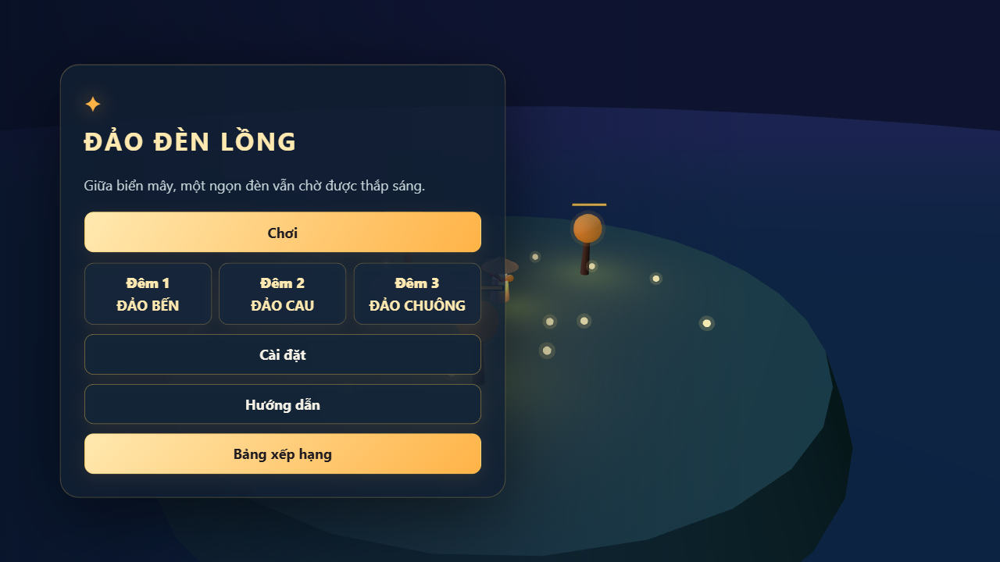

# [Video demo MP4](docs/demo/demo.mp4)


# Đảo Đèn Lồng — v1.0.0 / Contract 1.3
Nguyễn Minh Đạt · 2A202603582. Game 3D qua ba Đêm, thu thập đom đóm, duy trì dầu đèn và giữ đảo sáng tới bình minh. Sinh lực gọi là Ngọn Lửa.

## Yêu cầu hệ thống
Node.js 22+, npm, trình duyệt hiện đại hỗ trợ WebGL2, Windows/macOS/Linux. Đo benchmark cần Google Chrome cài trên máy (hoặc Microsoft Edge khi đặt LANTERN_BROWSER_CHANNEL=msedge). Cần mạng cho npm ci; game và bảng xếp hạng chạy cục bộ, không cần API key.

## Cài từ repo sạch — 3 lệnh
```sh
npm ci
npm run build
npm start
```
Mở địa chỉ terminal in ra. Nếu cổng 5173 đã dùng, đặt biến môi trường PORT khác. Chế độ phát triển: npm run dev. Gói web phát hành có dist/ và máy chủ Node; giải nén rồi chạy node scripts/run.js, không phải cài thư viện cho việc chơi.

## Menu ngoài game
Menu nền đảo 3D có Chơi (chuỗi từ Đêm 1), chọn Đêm 1/2/3, Cài đặt, Hướng dẫn và Bảng xếp hạng. Chọn Đêm riêng bắt đầu hành trình từ Đêm đó; điểm và nights_won chỉ tính các Đêm thực sự thắng. Có thể mở Cài đặt mà chưa vào màn chơi.

## Điều khiển và tiếp cận
WASD di chuyển theo camera, giữ chuột trái kéo để xoay; Space nhảy; Shift lướt; E nạp/châm dầu; Q Tỏa Sáng; Esc/P tạm dừng; R chơi lại. Trong Cài đặt có đổi từng phím (báo trùng, khôi phục mặc định), âm lượng, độ nhạy, bảng màu dễ phân biệt, chữ lớn ×1.25 và giảm chuyển động. Các lựa chọn được lưu theo trình duyệt. Chữ UI tối thiểu 18 px ở 1280×720. Giảm chuyển động tắt hiệu ứng xung sáng chuyển động; game không có rung camera hoặc chớp toàn màn hình. Đèn dầu thấp vẫn nhấp nháy trong thế giới theo yêu cầu gameplay.

## Luật
Đêm 1/2/3 dài 240/270/300 giây; cần ít nhất 3/5, 4/6, 5/7 đèn đang sáng khi hết giờ và còn Ngọn Lửa. Không thắng sớm. Đèn có 100 dầu, hao 1/giây; mỗi đom đóm châm thêm 10. Thắp mới giá 10, thắp lại giá 5. Dưới 30 dầu mất vùng an toàn và Bóng Mực có thể hút thêm 5 dầu/giây mỗi con. Sức chứa 10+2 mỗi lần thắp, tối đa 20. Bùa Gió là lá bùa đỏ viền vàng; Gió Lạc là dải lụa xám xanh, có nhãn phân biệt.
Điểm: +5/đom đóm nạp, +100 thắp mới, +40 thắp lại, +5 Bóng trúng pulse hoặc tổng +15 nếu đang drain; thắng bình minh thêm 50+floor(dầu) mỗi đèn sáng và 50 mỗi Ngọn Lửa. Bảng xếp hạng chỉ lưu tổng các Đêm đã thắng, top 10, điểm giảm dần và ai đạt trước đứng trên. Nhập tên 3–12 ký tự A–Z/a–z/0–9/_. Dữ liệu ở .local/leaderboard.json, không commit thông tin người chơi.

## Lệnh kiểm chứng
```sh
npm test
node scripts/verify-phase3.js
node src/headless.js --seed 42 --night 1 --ticks 600 --out output.jsonl
node scripts/bench.js --seed 42 --duration 30 --out bench.json
node --expose-gc scripts/soak.js --seed 7 --nights 10 --out soak.json
node scripts/run.js --export-leaderboard out.json
```
Headless hỗ trợ --scenario, --inputs, --snapshot-every. Benchmark mở cửa sổ Chrome viewport 1280×720, warmup 3 giây rồi đo đúng thời lượng yêu cầu: 200 Bóng Mực, 100 đom đóm, ba đèn đầy dầu, camera quay 15 giây/vòng. Các cờ --disable-gpu-vsync/--disable-frame-rate-limit được dùng, vsync_off phản ánh cấu hình đó. peak_mem_mb=null vì JavaScript web không đo RSS cả tiến trình một cách tin cậy. Bộ nhớ soak là RSS của tiến trình Node; chạy --expose-gc để thu gom rác ở cả hai mốc tải/reset, không phải số cấp phát heap ước lượng. Thời gian/độ mượt trên máy chấm có thể khác; không sửa số đo để đạt ngưỡng.

## Bằng chứng, demo và release
bench.json, soak.json, docs/phase-4.md và docs/proof chứa kết quả chạy thật. ADR Phase 3: docs/ADR-003.md. Retro: docs/RETRO.md. CHANGELOG có cả bốn phase; CREDITS và LICENSE ghi nguồn và phạm vi giấy phép.
Demo MP4 dưới 5 phút, ghi thật từ trình duyệt bằng scripts/record-demo.js, input chơi tự động, không phải tuyên bố người chơi đã thắng trọn ba Đêm. Video 5 fps không âm thanh, gồm gameplay, menu settings, dữ liệu test/bench/soak thực tế và cảnh benchmark. Số test hiển thị trong video là kết quả lúc ghi; báo cáo cuối có thể có thêm kiểm thử.
Gói web v1.0.0 nằm trong release/; Release notes chuẩn bị ở docs/RELEASE-v1.0.0.md. Bản phát hành: [v1.0.0](https://github.com/nguyenminhdat6401/K5-L3A-DAY12-NguyenMinhDat-2A202603582-AI-SDLC-Dao-Den-Long/releases/tag/v1.0.0). Mã tương ứng: [phase-4](https://github.com/nguyenminhdat6401/K5-L3A-DAY12-NguyenMinhDat-2A202603582-AI-SDLC-Dao-Den-Long/tree/phase-4).

## Giả định và sáng tạo
Đêm 3 xuất phát (0,0,-30) vì ticket không chỉ định, tránh nằm dưới tầng trung tâm; scenario ghi đè được. Bóng sinh thường có 30 tick spawning. Hình học, nhạc tổng hợp, quầng sáng và nhãn chỉ phục vụ trình bày. Các phần sáng tạo thêm bị tắt trong cảnh benchmark. ?previewNight=2 hoặc 3 thử từng Đêm; ?perf=1 hiện FPS; ?inspect=entities so hình dạng hai vật thể; ?previewFuel=29 dùng kiểm tra hiển thị dầu thấp. Các tùy chọn xem thử không thay headless.
